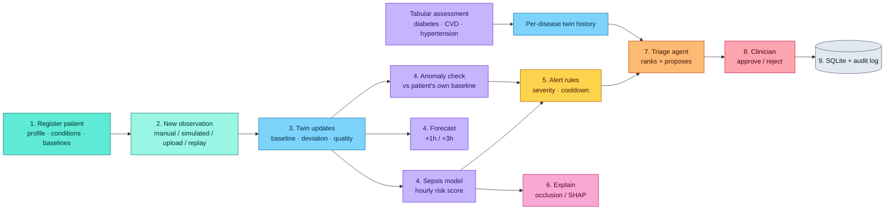
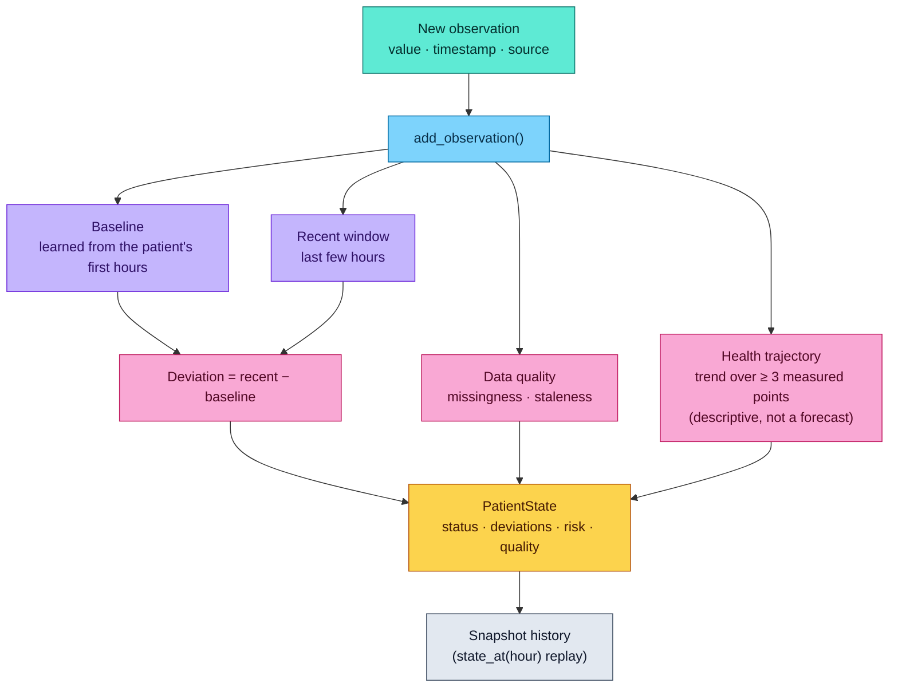
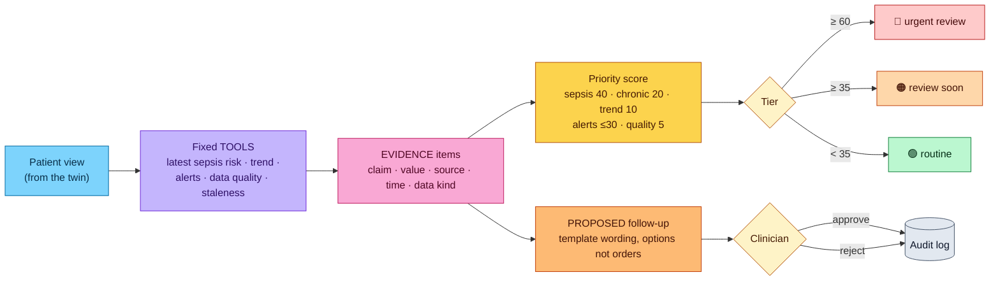
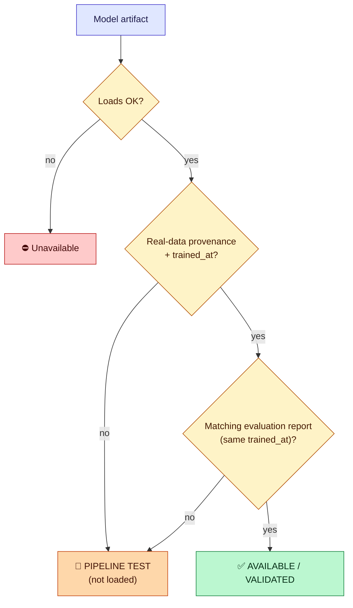
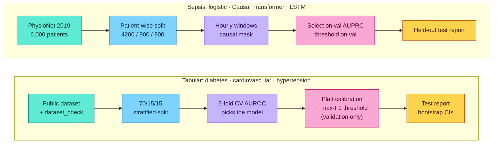

<div align="center">

# 🩺 HealthTwin

### multi-disease Digital Twin for remote patient monitoring


🫀 **Sepsis** · 🩸 **Type 2 Diabetes** · ❤️ **Cardiovascular** · 🩺 **Hypertension**

</div>

---

## ✨ What it does

| | Feature | In simple words |
|---|---|---|
| 🧬 | **Digital Twin** | Every patient gets a twin: own baseline, deviation from it, memory of past states, data quality, descriptive trends |
| 🧠 | **4 disease pipelines** | Sepsis, diabetes, cardiovascular, hypertension. Each has its own dataset, model, threshold, report. Nothing is shared |
| 📈 | **Forecast + ECG** | Short-horizon vital forecasts (+1h / +3h) vs a persistence baseline; separate ECG beat classifier |
| 🚨 | **Alert engine** | Severity, cooldown (no duplicate spam), escalation, acknowledge / resolve, audit trail |
| 🔍 | **Explainability** | SHAP for tabular models, occlusion for sepsis: which inputs pushed the score |
| 🧪 | **What-if** | "If this vital changes, how does the model score move?" A sensitivity test, not a treatment simulation |
| 🤖 | **Agentic triage** | Ranks patients with a transparent score and *proposes* follow-ups. A clinician approves or rejects |
| 🛡️ | **Availability gate** | A model shows as available only with real-data provenance + a matching evaluation report |

---

## 🏗️ System architecture (layer by layer)

```mermaid
flowchart TB
    subgraph L1["1️⃣ DATA SOURCES (every row is tagged with its kind)"]
      direction LR
      D1["✍️ manual_entry"]:::src
      D2["📤 uploaded CSV"]:::src
      D3["🎛️ simulated_live"]:::sim
      D4["🧪 synthetic_demo"]:::sim
      D5["📼 historical_replay<br/>(real PhysioNet records)"]:::real
    end
    subgraph L2["2️⃣ INGESTION"]
      direction LR
      I1["Schema + validation<br/>34 model inputs"]:::ing
      I2["Preprocessing<br/>(fit on train patients only)"]:::ing
    end
    subgraph L3["3️⃣ DIGITAL TWIN CORE"]
      direction LR
      T1["DigitalTwin<br/>baseline · recent window<br/>deviation · data quality"]:::twin
      T2["Anomaly detector<br/>own-baseline z-score"]:::twin
      T3["Health trajectory<br/>(descriptive, ≥3 points)"]:::twin
    end
    subgraph L4["4️⃣ MODEL LAYER (gate-checked)"]
      direction LR
      M1["Sepsis<br/>Logistic · Causal Transformer · LSTM"]:::ml
      M2["Diabetes · CVD · Hypertension<br/>separate tabular models"]:::ml
      M3["Forecast Ridge<br/>vs persistence"]:::ml
      M4["ECG beats<br/>HistGradientBoosting"]:::ml
    end
    subgraph L5["5️⃣ DECISION SUPPORT"]
      direction LR
      A1["Alert engine<br/>severity · cooldown · escalate"]:::dec
      A2["Insights + SHAP / occlusion"]:::dec
      A3["Triage agent<br/>score · evidence · proposals"]:::dec
    end
    subgraph L6["6️⃣ STORAGE + ACCESS"]
      direction LR
      S1[("SQLite<br/>patients · observations · predictions<br/>assessments · alerts · proposals · audit")]:::db
      S2["🖥️ Streamlit app<br/>11 pages"]:::ui
    end
    L1 --> L2 --> L3 --> L4 --> L5 --> L6
    classDef src fill:#e0e7ff,stroke:#4338ca,color:#1e1b4b
    classDef sim fill:#fed7aa,stroke:#c2410c,color:#431407
    classDef real fill:#bbf7d0,stroke:#15803d,color:#052e16
    classDef ing fill:#5eead4,stroke:#0f766e,color:#042f2e
    classDef twin fill:#7dd3fc,stroke:#0369a1,color:#082f49
    classDef ml fill:#c4b5fd,stroke:#6d28d9,color:#2e1065
    classDef dec fill:#f9a8d4,stroke:#be185d,color:#500724
    classDef db fill:#fcd34d,stroke:#b45309,color:#451a03
    classDef ui fill:#7dd3fc,stroke:#0369a1,color:#082f49
```



**Data kinds are never mixed.** Every observation carries a `source`. Charts, tables, exports and the timeline show it; simulated and synthetic rows are flagged. What-if runs live in their own table and are never saved as observations. Forecasts are drawn as separate markers.

---

## 🔄 How it works, step by step



1. **Register** a patient (name, age, gender, conditions, history, optional baseline vitals, synthetic flag).
2. **Add observations** on the *Live* page: manual entry, labelled simulated feed, upload, or replay of a real public record.
3. **The twin updates itself**: it learns the patient's own baseline from the first hours, measures deviation from it, tracks data quality and keeps all past states (restart-safe: rebuilt from SQLite).
4. **Models run on what is already recorded** (no future data; tested). Sepsis gives an hourly risk score; the anomaly detector flags values far from the patient's *own* baseline; forecasts project vitals.
5. **Alert engine** turns scores and anomalies into alerts with severity, 6-hour cooldown against duplicates, and escalation for unreviewed critical alerts.
6. **Explain**: occlusion (sepsis) or local SHAP (tabular) shows which inputs moved the score.
7. **Triage agent** collects evidence for every patient and ranks them.
8. **A clinician decides.** Nothing executes without approve / reject.
9. **Everything is stored**, including who decided and when.

### 🧬 Inside the Digital Twin



### 🤖 Agentic triage (offline, deterministic, human-in-the-loop)



- Duplicate alerts are grouped into one incident. Weights live in the config, so they can be tuned.
- An optional LLM may only *reword* the template text, and its output is **discarded if it adds any number not already in the evidence**. It is off by default.

### 🛡️ Model availability gate



### 🧠 How each model is trained



The Transformer uses a strict upper-triangular attention mask, so it **cannot see later hours**. Preprocessing is fitted on training patients only. Tabular datasets are cross-sectional, so no fake time dimension is created for them.

---

## 📊 Results (real public data, held-out test split)

All numbers come from `reports/*_metrics.json`, measured on held-out patients.

| Model | Data | AUROC | Other metrics | Honest note |
|---|---|:---:|---|---|
| 🫀 Sepsis (logistic) | PhysioNet/CinC 2019, 6,000 ICU patients | **0.765** | AUPRC 0.061 (prevalence 1.8%), precision 0.094, recall 0.167 | Early-warning baseline; sepsis is rare (1.8%), so AUPRC is low for every model |
| ⚡ Causal Transformer | same patients, hourly windows | **0.761** | AUPRC 0.095 | Comparable to the row-wise baseline (AUROC 0.768, AUPRC 0.076); slightly higher AUPRC |
| 🔁 LSTM | same windows | **0.758** | AUPRC 0.080 | Sequence comparator |
| 🩸 Diabetes | Pima Indians, 768 women | **0.845** | 95% CI 0.776–0.909, F1 0.710, recall 0.805 | Strongest model here; small test set (n = 116) |
| ❤️ Cardiovascular (10-yr CHD) | Framingham teaching subset | **0.697** | precision 0.252, recall 0.562, F1 0.348 | Risk-ranking model |
| 🩺 Hypertension screening | Framingham (BP readings excluded) | **0.773** | precision 0.464, recall 0.756, F1 0.575 | Screening estimate |
| 📈 Forecast | ICU vitals | n/a | beats persistence on most vitals (e.g. HR 1h MAE 4.80 vs 4.96) | O2Sat and Temp 1h turned off by the project's rule |
| 💓 ECG beats | MIT-BIH, 48 records | n/a | macro-F1 0.548 (always-Normal: 0.236) | Beats the always-Normal baseline by a wide margin; supraventricular class is the hardest (F1 ≈ 0.19) |

---

## 🚀 Quick start (Windows PowerShell)

```powershell
python -m venv .venv
.\.venv\Scripts\Activate.ps1
python -m pip install --upgrade pip
pip install -r requirements.txt
python scripts/check_environment.py     # shows which models are VALIDATED
python -m pytest -q                     # tests use SYNTHETIC data only
streamlit run app.py
```

If activation is blocked: `Set-ExecutionPolicy -Scope CurrentUser RemoteSigned`

---

## 🖥️ App pages

| Page | Purpose |
|---|---|
| 🏠 Overview | System status and model availability |
| 👥 Patients | Register and select patients |
| 🪪 Profile | Patient details and baselines |
| 🧬 Twin | Baseline, deviation, trajectory |
| 📡 Live | Add observations / labelled simulated replay |
| 🔮 Prediction | Disease risk estimates + SHAP |
| 🕒 Timeline | Stored history |
| 🧪 What-if | Model sensitivity analysis (not a treatment simulation) |
| 💡 Insights | Occlusion explanations |
| 🚨 Alerts | Triage agent: run, approve, reject |
| 🗂️ Data | Data provenance |

---

## 🧰 Reproduce the training

<details>
<summary><b>Tabular diseases (diabetes, cardiovascular, hypertension)</b></summary>

```powershell
python scripts/download_tabular.py        # Pima + Framingham teaching subset, records provenance
python scripts/train_tabular.py           # or: python scripts/train_tabular.py diabetes
```
Each disease has its own dataset, features, model, calibration, threshold, report and artifact folder. 70/15/15 stratified split, model chosen by 5-fold CV AUROC, threshold chosen on validation only.
</details>

<details>
<summary><b>Sepsis, Transformer/LSTM, forecasting, ECG</b></summary>

```powershell
python scripts/download_sepsis.py --limit 3000 --workers 8
python scripts/prepare_sepsis_data.py
python scripts/train_sepsis.py
python scripts/train_causal_transformer.py --epochs 8 --batch-size 256
python scripts/train_forecast.py
python scripts/download_ecg.py
python scripts/train_ecg.py
python scripts/check_environment.py
```
Already downloaded PhysioNet files yourself? Use `python scripts/prepare_sepsis_data.py --confirm-physionet-origin` (or `--zip file.zip`).
Everything at once: `scripts/train_all.ps1`.
</details>

<details>
<summary><b>No local setup? Use Google Colab</b></summary>

Open `colab_train_remaining.ipynb` in Colab, upload the project ZIP, run all cells, download `trained_results.zip`, and merge it into `artifacts/`, `reports/`, `data/processed/`. Then run `python scripts/check_environment.py`.
</details>

> `scikit-learn` is pinned to **1.6.1** because saved models are pickles; a different version may fail to load them

---

## 📁 Project layout

```
app.py                  Streamlit app
src/
  agents/               triage agent
  services/             oversight, twin, registry
  diseases/             per-disease pipelines
  database/             SQLite store
  utils/provenance.py   availability gate
scripts/                download, train, check
artifacts/  reports/    trained models and evaluation reports
docs/                   guides and phase reports
tests/                  pytest suite
```

More: `docs/platform_guide.md`, `docs/system_architecture.md`, `docs/PROJECT_STATUS.md`, `docs/PHASE4_REPORT.md`, `docs/PHASE5_REPORT.md`, `docs/PHASE6_REPORT.md`.

---

<div align="center">

**Priyanshi Mehta** · B.Tech CSE (AI) · JK Lakshmipat University


</div>
