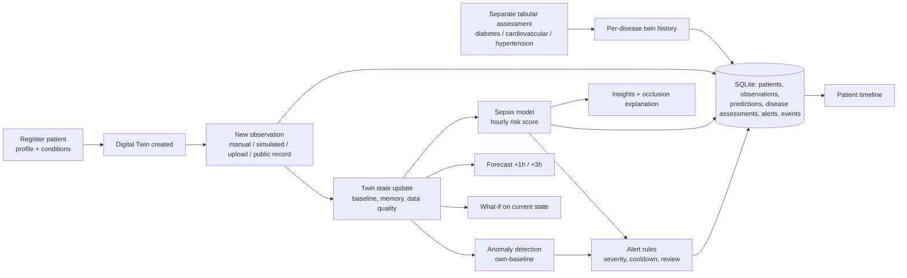

# HealthTwin - System Architecture

> Research prototype. Data are public historical records (replayed), SYNTHETIC demo data, SIMULATED live data, manual entries or uploads. No hospital, device or wearable is connected.

## 1. Patient journey

## 2. Modules (src/)

| Package | Main pieces | Responsibility |
|---|---|---|
| services | `patient_service.py` (`PatientService`) | Patient workflow plus validated point-in-time tabular disease assessments, stored per patient and disease |
| digital_twin | `twin.py`, `engine.py`, `models.py`, `whatif.py` | `DigitalTwin`, `TwinEngine`, `Observation` (with timestamp + source), state-based and trajectory what-if |
| database | `db.py`, `patient_store.py` | SQLite. `PatientStore` adds patients, observation metadata, timeline events, what-if runs and per-disease assessment history |
| data_ingestion | `schema.py`, `upload.py`, `sepsis_loader.py` | Exact model input schema (34 measurable inputs), validation, upload checks |
| models | `sepsis_*`, `causal_transformer.py`, `explain.py` | Row-wise sepsis baseline, causal Transformer/LSTM sequence training, inference and occlusion explanation |
| alerts | `manager.py` | Rules, severity, cooldown, escalation, acknowledgement, audit trail |
| anomaly_detection | `rolling.py` | Per-patient baseline detector |
| forecasting | `baselines.py` | Ridge forecasts vs persistence baseline |
| diseases | `registry.py`, `tabular.py` | Separate diabetes, cardiovascular and hypertension models; only models with verified real-data artifacts and evaluation reports are available |
| simulation | `replay.py`, `feed.py`, `builders.py` | Replay engine, labelled simulated live feed |
| insights | `evidence.py`, `narrative.py` | Evidence-based insights with source and time |
| ecg | loader, beats, train, inference | Separate record-level ECG module (MIT-BIH) |
| ui | `theme.py` | Styling and HTML components |

## 3. Data kinds are never mixed

Every observation carries a `source`: `manual_entry`, `simulated_live`, `synthetic_demo`, `uploaded`, `historical_dataset`, `historical_replay`. The twin, charts, tables, exports and timeline show it; simulated/synthetic rows are flagged. What-if scenarios live in their own table and are never written as observations; forecasts are drawn as separate markers.

## 4. Temporal sequence modelling (Phase 5)
- The Causal Transformer uses hourly sepsis histories with a strict upper-triangular attention mask; it cannot attend to later tokens.
- Windows are chronological and patient-local, and the existing patient-wise train/validation/test assignments are reused. Preprocessing is fitted on training patients only.
- An LSTM comparator is trained on identical windows. Model selection and threshold selection use validation data; final metrics are reported on the held-out test split.
- The sequence training script is not automatically run by the dashboard. A real-data training run is required before any model can be described as trained or evaluated.
- The non-sepsis tabular datasets remain cross-sectional; no synthetic time dimension is fabricated for them.

## 5. Key design decisions
- **One twin per patient**, namespaced `sepsis:<patient id>`. Tabular diabetes, cardiovascular and hypertension assessments are attached to that patient's twin with their own per-disease histories; they remain point-in-time estimates, not temporal forecasts.
- **No future data:** the model receives only the observations already recorded; tested.
- **Twin state is reconstructable:** observations, sepsis predictions, per-disease assessments and alerts are persisted; after a restart the twin histories are rebuilt from SQLite.
- **Graceful degradation:** with no model or data every page still renders (empty states, "model unavailable").
- **Human oversight:** alerts only change review status; nothing triggers an action.

## Phase 6 — longitudinal patient Twin analytics

The existing DigitalTwin remains the source of patient-specific state. Phase 6 adds a derived `health_trajectory` summary to patient snapshots. It calculates a descriptive linear trend for each vital using the most recent available measured points only (minimum three distinct observation hours), ignores missing measurements, and records the point count and observed time span. The output explicitly sets `clinical_forecast: false`; it must not be presented as a diagnosis, treatment recommendation, or validated future-risk forecast.

`baseline_quality` indicates whether the earliest patient-specific baseline has enough observations to be considered established. It does not substitute population reference ranges. Disease-specific tabular assessments remain point-in-time screening estimates stored separately from temporal observation trends.
